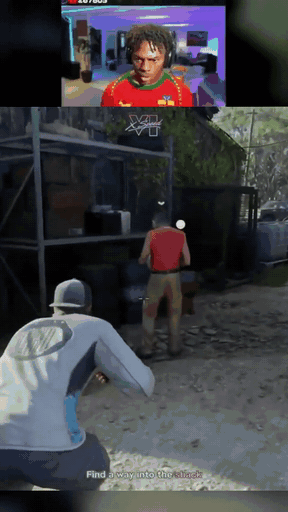
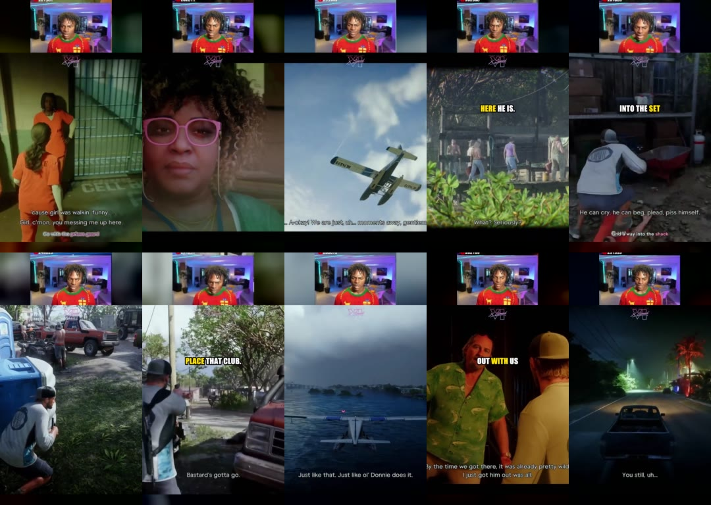
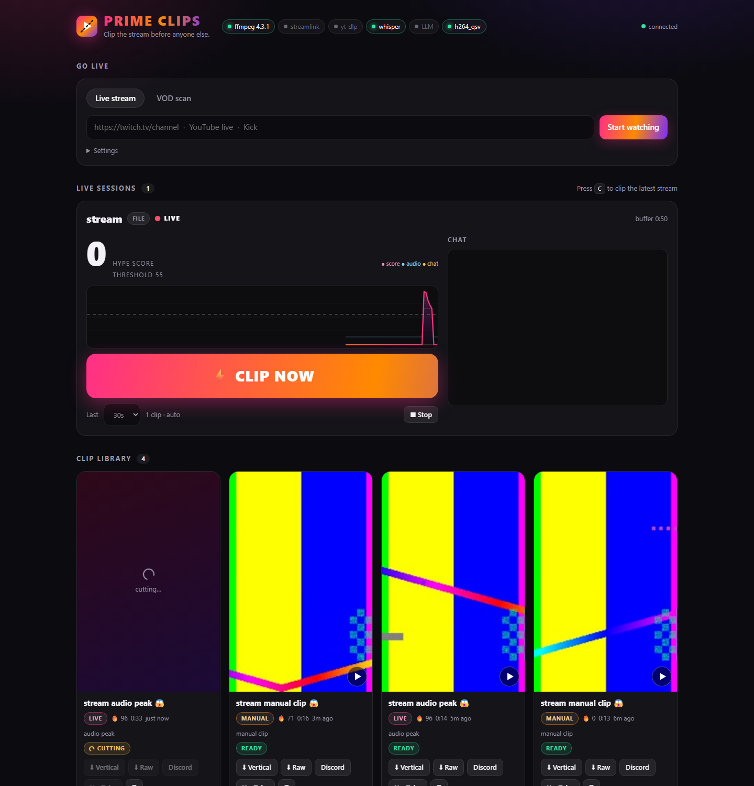
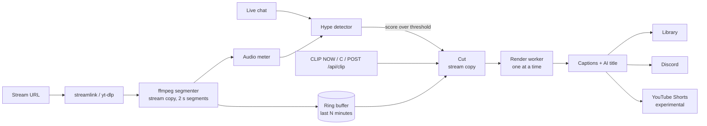
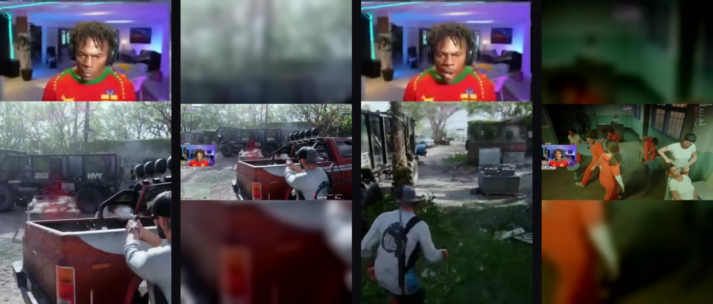

<div align="center">

# ⚡ Prime Clips

### Clip the stream before anyone else.

**Real-time, open-source live-stream clipper.** It watches a live stream, keeps a rolling replay buffer, spots hype moments (audio spikes, chat explosions, "CLIP IT" spam) and cuts a vertical 9:16 short in seconds.

[](https://www.python.org/)
[](LICENSE)
[](https://fastapi.tiangolo.com/)
[](https://ffmpeg.org/)
[](https://github.com/debanganghosh08/Prime_Clips/stargazers)
[](https://www.instagram.com/primus.builds/)

### ⭐ [Star the repo](https://github.com/debanganghosh08/Prime_Clips) so other clippers can find it

</div>

## 🎬 Real output

One command, a 35-minute stream in, ready-to-post shorts out:

```bash
primeclips vod https://youtu.be/kR8bhkVAgBY --top 10 --layout streamer --captions --delete-source
```

<table>
<tr>
<td align="center" width="34%">
<br>
<sub>🎮 <code>streamer</code> layout + karaoke captions · <a href="docs/assets/demo.mp4">▶️ watch with sound</a></sub>
</td>
<td align="center">
<br>
<sub><b>10 moments detected automatically</b>, spread across the whole stream (2:07 → 33:31), each a 32 s 9:16 short with captions.<br>
Downloaded, clipped and rendered on a laptop; the 700 MB source was deleted automatically afterwards.<br>
👉 <a href="examples/clips"><b>Watch all 10 clips</b></a></sub>
</td>
</tr>
</table>

<sub>Source: <a href="https://youtu.be/kR8bhkVAgBY">iShowSpeed's First Time Playing GTA 6! (SpeedUniverse)</a>, used to demo the clipping pipeline.</sub>

<div align="center">



<sub>The dashboard: a live session with the hype meter catching a spike while an auto clip is cut in real time.</sub>

</div>

---

## 🎯 Why

When a mega-launch game drops (hello, GTA 6 hype), **every streamer plays it**, and every clipper races to post the viral moment first.

- 🥇 The **first upload** gets the views.
- 💰 Streamers pay **clip bounties and campaigns** for it.
- ⏱️ Scrubbing a VOD afterwards is too slow, the moment is already everywhere.

Prime Clips sits on the live stream with a replay buffer, so the clip already exists when you press the button (or when the detector fires on its own).

---

## ✨ Features

| | Feature | What it does |
|---|---|---|
| ⏪ | **Replay buffer** | ffmpeg stream-copies the live stream into ~2 s segments and keeps a rolling window (10 min by default). Cutting is a stream copy, no re-encode. |
| 🔥 | **Hype detector** | Fuses audio loudness, chat message rate and hype words/emotes (plus viewers typing "clip") into a 0-100 score, relative to that stream's own baseline. |
| ⚡ | **CLIP NOW** | Dashboard button, the **C** hotkey, and `POST /api/clip` for a Stream Deck or any hotkey tool. |
| 📱 | **5 layouts** | `vertical-blur`, `streamer` (facecam on top + 3:4 gameplay over a blurred backdrop), `gaming` (edge-to-edge stack), `crop`, `landscape`. |
| 🎮 | **GPU encoders** | Auto-detects NVENC / QSV / AMF (and VideoToolbox on macOS), falls back to x264. Child processes run at low priority. |
| 💬 | **Karaoke captions** | Word-by-word, bold UPPERCASE, active word in electric yellow, placed per layout just below the facecam (faster-whisper, optional). |
| 🔊 | **Sync & loudness** | Every render resets audio/video timestamps to zero (no drift) and normalises to -14 LUFS like Shorts/TikTok. |
| 🤖 | **AI titles** | Any OpenAI-compatible LLM: Ollama, OpenRouter, Gemini, and so on. Optional. |
| 📣 | **Discord webhook** | Ping the finished clip to your phone or team, optionally automatically. |
| 📺 | **YouTube Shorts upload** | 🧪 *Experimental, untested.* |
| 🎞️ | **VOD mode** | Point it at a finished stream (URL or local file) and get the top N moments. |
| 🖥️ | **Terminal mode** | `primeclips live <url>`, press Enter to clip. |
| 🐳 | **Docker** | `docker compose up`. |

> ✅ **Tested end-to-end:** Twitch live ingest via streamlink + Twitch chat, YouTube VOD download with browser cookies, burned-in karaoke captions, local file input, replay buffer, auto and manual clips, all 5 layouts, GPU encoding (Intel QSV), VOD mode, terminal mode and the dashboard.
>
> 🧪 **Not tested yet (experimental):** YouTube *live* ingest + chat, Kick, AI titles, LLM moment picking (VOD `--ai`), Discord webhook, YouTube upload and Docker. Issues and PRs are very welcome!

Chat signal support today: **Twitch** (anonymous IRC, no account or API key) and **YouTube** (experimental, needs the `youtube-chat` extra). Other platforms fall back to audio-only detection.

---

## 🧠 How it works



**Why it is fast and light on CPU**

- ✂️ **Stream copy everywhere possible.** The buffer is written with `-c copy` and a clip is just the segments that cover your time range concatenated, no decode or encode.
- 🧱 **Small segments.** The buffer is cut into 2 s segments (`PRIMECLIPS_SEGMENT_SECONDS`), so the start of a clip snaps to a segment boundary quickly.
- 🪫 **One render at a time.** A single render worker handles re-encodes, so the CPU/GPU stays free for the game and the stream. Cuts never wait in that queue.
- 🎮 **GPU encoder auto-detect.** It test-encodes a frame to find a working hardware encoder instead of assuming one.
- 🐢 **Below-normal priority.** ffmpeg and helper processes are spawned at low priority by default (`PRIMECLIPS_LOW_PRIORITY`).
- 📉 **Cheap detection.** No ML model for hype scoring, just loudness and chat statistics.

The pre/post window is deliberate: chat reacts a few seconds *after* the moment, so auto clips keep 25 s before and 8 s after the trigger by default.

---

## 🖼️ Layouts

<div align="center">

</div>

Real frames rendered by Prime Clips: **gaming** (1st and 3rd) and **vertical-blur** (2nd and 4th). The **streamer** layout is the one in the 🎬 Real output demo above.

| Layout | Use it for |
|---|---|
| `vertical-blur` (default) | Full frame centred over a blurred copy of itself. Safe for anything. |
| `streamer` | Facecam centred on top, gameplay cropped to 3:4 below it, over a dark blurred backdrop. Set `PRIMECLIPS_FACECAM`. |
| `crop` | Hard centre crop to 9:16. Action or a face in the middle. |
| `gaming` | Facecam on top, gameplay below. Set `PRIMECLIPS_FACECAM` to where the facecam sits. |
| `landscape` | Keep 16:9 (only re-encoded if captions are burned in). |

---

## 🚀 Quick start

**1. Install ffmpeg**

```bash
# Windows
winget install Gyan.FFmpeg
# macOS
brew install ffmpeg
# Linux (Debian/Ubuntu)
sudo apt install ffmpeg
```

**2. Install Prime Clips** (Python 3.10+)

```bash
git clone https://github.com/debanganghosh08/Prime_Clips.git
cd Prime_Clips
python -m venv .venv

# Windows (PowerShell)
.venv\Scripts\Activate.ps1
# macOS / Linux
source .venv/bin/activate

pip install -e .            # core: dashboard, Twitch/Kick/YouTube ingest
# or everything optional (captions, YouTube chat, YouTube upload):
pip install -e ".[all]"
```

**3. Check your setup**

```bash
primeclips doctor
```

**4. Launch the dashboard**

```bash
primeclips serve --open
```

**🐳 Docker instead**

```bash
docker compose up
```

Then open http://localhost:8765. Clips land in `./data/clips/`.

> 🔒 The dashboard has no login. Keep it on `localhost` or a trusted network, do not expose it to the internet.

---

## 🎮 Usage

### 🖥️ Dashboard

Run `primeclips serve --open`, paste a live URL, pick a layout and threshold, and start. Hit **⚡ CLIP NOW** or press **C** (when you are not typing in a field) to clip the last N seconds of the most recent live session.

### ⌨️ Terminal live mode

```bash
primeclips live https://twitch.tv/xyz --layout gaming
```

Press **Enter** to clip the last 30 s, type a number then **Enter** to clip the last N seconds, **q** to quit. Useful flags: `--threshold`, `--pre`, `--post`, `--no-auto`, `--no-chat`, `--captions`.

### 🎞️ VOD mode

```bash
primeclips vod https://www.twitch.tv/videos/123456789 --top 5
primeclips vod ./stream.mp4 --top 3 --layout gaming --captions
primeclips vod https://youtu.be/<id> --top 10 --layout streamer --captions --delete-source
```

Finds the hype moments with a rolling local loudness baseline, **spread across the whole stream**, so 10 clips means 10 different sections. Flags: `--top`, `--layout`, `--captions`, `--min-len`, `--max-len`, `--delete-source`, and `--ai` (🧪 experimental: an LLM picks moments from the transcript using a hook / engagement / value / shareability rubric; needs an LLM and faster-whisper).

### 🧹 Downloads & cleanup

When you clip a VOD, Prime Clips **downloads the source video** to `data/downloads/` (a 35-min stream at 720p is about 700 MB) and writes clips to `data/clips/`. Remove what you don't need:

```bash
primeclips vod <url> --delete-source   # delete the download as soon as the clips are cut
primeclips clean                       # delete all downloads + leftover buffers (keeps clips)
primeclips clean --all                 # also delete every clip
```

Using an AI agent? One prompt does it: *"Read prompt.md and clean up Prime Clips' downloads"* (see prompt **12** in [prompt.md](prompt.md)).

### 🎛️ Stream Deck / hotkey

Any tool that can send an HTTP request works:

```bash
curl -X POST http://localhost:8765/api/clip \
  -H "Content-Type: application/json" \
  -d '{"seconds": 30}'
```

It clips the most recent live session. Full route list in [docs/API.md](docs/API.md).

### 🏁 Pro tips for winning the race

- 📉 **Lower the threshold** for chill streamers (their big moments are quieter in absolute terms, try `--threshold 55`).
- 🚫 **Captions off for speed.** They cost CPU and seconds, and being first matters more than being pretty.
- 📣 **Set a Discord webhook** (`PRIMECLIPS_DISCORD_WEBHOOK`, optionally `PRIMECLIPS_DISCORD_AUTO=true`) and post straight from your phone.
- 🧑‍🚀 **Set `PRIMECLIPS_FACECAM`** (`x,y,w,h` as fractions of the frame, default `0,0,0.28,0.30`) so the `gaming` layout crops the right corner. The demo above used `PRIMECLIPS_FACECAM=0,0.415,0.205,0.235` (facecam on the left edge, mid-height).
- ⌨️ **Keep a hotkey ready.** Manual clip plus auto-detect together beat either alone.

---

## ⚙️ Configuration

Everything is driven by `PRIMECLIPS_*` environment variables or a `.env` file in the folder you run from. Copy [`.env.example`](.env.example) to `.env` and uncomment what you want to change.

| Variable | Default | Description |
|---|---|---|
| `PRIMECLIPS_DATA_DIR` | `data` | Where clips, buffers and downloads live |
| `PRIMECLIPS_FFMPEG` / `PRIMECLIPS_FFPROBE` | `ffmpeg` / `ffprobe` | Binary names or paths |
| `PRIMECLIPS_SEGMENT_SECONDS` | `2.0` | Replay buffer segment length |
| `PRIMECLIPS_BUFFER_MINUTES` | `10.0` | Rolling replay buffer length |
| `PRIMECLIPS_QUALITY` | `best` | Stream quality passed to streamlink / yt-dlp |
| `PRIMECLIPS_COOKIES_FROM_BROWSER` | *(empty)* | `firefox` / `chrome` / `edge` / `brave`: lets yt-dlp use your YouTube login |
| `PRIMECLIPS_COOKIES_FILE` | *(empty)* | Path to an exported `cookies.txt` (wins over the browser option) |
| `PRIMECLIPS_VOD_MAX_HEIGHT` | `1080` | Max resolution for VOD downloads (`720` downloads ~2x faster) |
| `PRIMECLIPS_ENCODER` | `auto` | `auto`, `libx264`, `h264_nvenc`, `h264_qsv`, `h264_amf` |
| `PRIMECLIPS_THREADS` | `2` | Threads for x264 and captions |
| `PRIMECLIPS_LOW_PRIORITY` | `true` | Run child processes at low priority |
| `PRIMECLIPS_RENDER_FPS` | `30` | Output fps (`source` keeps the original) |
| `PRIMECLIPS_FACECAM` | `0,0,0.28,0.30` | Facecam rectangle `x,y,w,h` for the `gaming` layout |
| `PRIMECLIPS_LAYOUT` | `vertical-blur` | Default layout |
| `PRIMECLIPS_AUTO_CLIP` | `true` | Auto-clip on hype |
| `PRIMECLIPS_THRESHOLD` | `70` | Hype score (0-100) that triggers an auto clip |
| `PRIMECLIPS_PRE` / `PRIMECLIPS_POST` | `25` / `8` | Seconds kept before / after the trigger |
| `PRIMECLIPS_COOLDOWN` | `45` | Minimum seconds between two auto clips |
| `PRIMECLIPS_CHAT` | `true` | Read live chat |
| `PRIMECLIPS_CAPTIONS` | `false` | Burn captions (needs faster-whisper) |
| `PRIMECLIPS_WHISPER_MODEL` | `base` | faster-whisper model name |
| `PRIMECLIPS_WHISPER_DEVICE` | `auto` | `auto` tries the GPU and falls back to CPU if CUDA libraries are missing; or `cpu` / `cuda` |
| `PRIMECLIPS_CAPTION_FONT` | `Impact` | Caption font (falls back automatically if not installed) |
| `PRIMECLIPS_LLM_BASE_URL` | *(empty)* | Any OpenAI-compatible `/v1` endpoint |
| `PRIMECLIPS_LLM_API_KEY` | *(empty)* | API key (not needed for local Ollama) |
| `PRIMECLIPS_LLM_MODEL` | *(empty)* | Model name |
| `PRIMECLIPS_TITLE_TEMPLATE` | `{channel} {reason} 😱` | Fallback title when no LLM title is made |
| `PRIMECLIPS_HASHTAGS` | `#shorts #gaming #clips` | Appended to Discord / YouTube posts |
| `PRIMECLIPS_DISCORD_WEBHOOK` | *(empty)* | Discord webhook URL |
| `PRIMECLIPS_DISCORD_AUTO` | `false` | Post every finished clip automatically |
| `PRIMECLIPS_YOUTUBE_CLIENT_SECRETS` | *(empty)* | Path to OAuth `client_secrets.json` (🧪 experimental) |
| `PRIMECLIPS_YOUTUBE_PRIVACY` | `public` | Privacy status for YouTube uploads (🧪 experimental) |

AI titles need both `PRIMECLIPS_LLM_BASE_URL` and `PRIMECLIPS_LLM_MODEL`, for example Ollama at `http://localhost:11434/v1`.

---

## 🩺 Troubleshooting

The full problem sheet is in **[docs/TROUBLESHOOTING.md](docs/TROUBLESHOOTING.md)**. The three most common fixes:

| Problem | Fix |
|---|---|
| YouTube: *"Sign in to confirm you're not a bot"* | Sign in to YouTube in **Firefox**, close it, then set `PRIMECLIPS_COOKIES_FROM_BROWSER=firefox` |
| YouTube: *"Requested format is not available"* | `pip install -U "yt-dlp[default]"` and install **Node.js** (used automatically) |
| `primeclips` / `yt-dlp` *"not recognized"* | Use `python -m primeclips ...` / `python -m yt_dlp ...`, or activate the venv |

---

## 🤖 Use it with your AI agent: we ship a dedicated [prompt.md](prompt.md)

Prime Clips is built to be driven by **Claude Code, Antigravity, Gemini, Cursor, Codex or ChatGPT**. **[prompt.md](prompt.md)** is written *for your AI agent*. It has:

- 🧭 **An agent playbook:** what to do when you hand it this repo's link, a live URL, a VOD, a local file or "open the web UI", plus every known edge case (no Python, no ffmpeg, YouTube bot wall, 429, no GPU, low disk, wrong facecam position).
- 📘 **A source-of-truth brief:** pipeline, file map and the rules the code follows.
- 🧰 **14 copy-paste prompts:** clone-and-run, clip this video, fix an error, unblock YouTube, tune the detector, add a layout / platform / upload target, make it lighter on your PC, clean up, a no-install fallback, and a PR review.

> 💬 Just tell your agent: *"Clone https://github.com/debanganghosh08/Prime_Clips, read `prompt.md` and treat it as the source of truth."*

---

## 🧭 No setup? Other ways to clip

Our motto: **everyone who wants to clip should be able to.** If you can't run Prime Clips on your machine yet, these work from the browser or your AI chat:

| Way | How |
|---|---|
| 🤖 **Your AI agent, no install** | Paste prompt **11** from [prompt.md](prompt.md) into Claude Code / Antigravity / Gemini CLI. It runs the same pipeline (sync-safe cuts, facecam-on-top layout, karaoke captions) with plain ffmpeg. |
| 🔌 **OpusClip in Claude** | Add the [OpusClip connector](https://help.opus.pro/api-reference/claude-connector) in Claude, then ask: *"[YouTube link] Make 5 viral vertical clips with captions and write an Instagram caption for each."* Uses OpusClip's processing minutes. |
| 🌐 **Web clippers** | [OpusClip](https://www.opus.pro) or [ScaleReach](https://index.dodopayments.com/scalereach): paste a YouTube link, get captioned vertical clips (free tiers have limited minutes). |

**💰 Getting paid for clips:** join a creator's clipping campaign on **Vyro** (the clipping marketplace backed by MrBeast) or [Whop](https://whop.com) Content Rewards, clip *their* videos, post, and submit the link. You're paid on approved, verified views, and every campaign sets its own rate.

---

## 🗺️ Roadmap

- [ ] Kick chat
- [ ] TikTok / Instagram upload
- [ ] Sentence-aware clip edges (snap start/end to transcript sentences)
- [ ] Face-tracking reframe for talking-head VODs (optional extra)
- [ ] Skip frozen / BRB / "starting soon" screens automatically
- [ ] Burned-in hook title for the first 3 seconds
- [ ] Multi-stream dashboard grid
- [ ] OBS plugin
- [ ] Per-game event detectors (kill feed, wanted-level OCR)

---

## 🧱 Built with

[FFmpeg](https://ffmpeg.org) · [streamlink](https://github.com/streamlink/streamlink) · [yt-dlp](https://github.com/yt-dlp/yt-dlp) · [FastAPI](https://fastapi.tiangolo.com) · [faster-whisper](https://github.com/SYSTRAN/faster-whisper) (optional)

---

## ⚖️ Responsible clipping

Clipping is a community practice, not a free pass.

- 🤝 **Respect streamers and platforms.** Follow each streamer's clipping rules and the platform's terms of service.
- ✅ **Get permission or join official clip campaigns** before reposting or monetizing someone's content.
- 🔐 Prime Clips **does not bypass DRM or paywalls**. It only reads streams you could already watch.
- 📛 Credit the streamer when you post.

You are responsible for what you publish.

---

## 🤝 Contributing

Bug reports, ideas and PRs are welcome. See [CONTRIBUTING.md](CONTRIBUTING.md).

```bash
pip install pytest && python -m pytest -q   # fast tests, no ffmpeg or network needed
```

## 📄 License

[MIT](LICENSE) © 2026 Debangan Ghosh

---

<div align="center">

Made with ❤️ by **Debangan Ghosh**

<a href="https://www.instagram.com/primus.builds/"></a>

[@primus.builds](https://www.instagram.com/primus.builds/)

If this saved you time, ⭐ the repo and follow for more builds.

</div>
