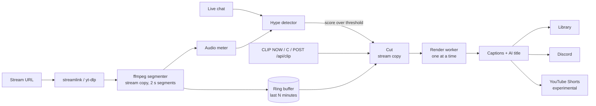
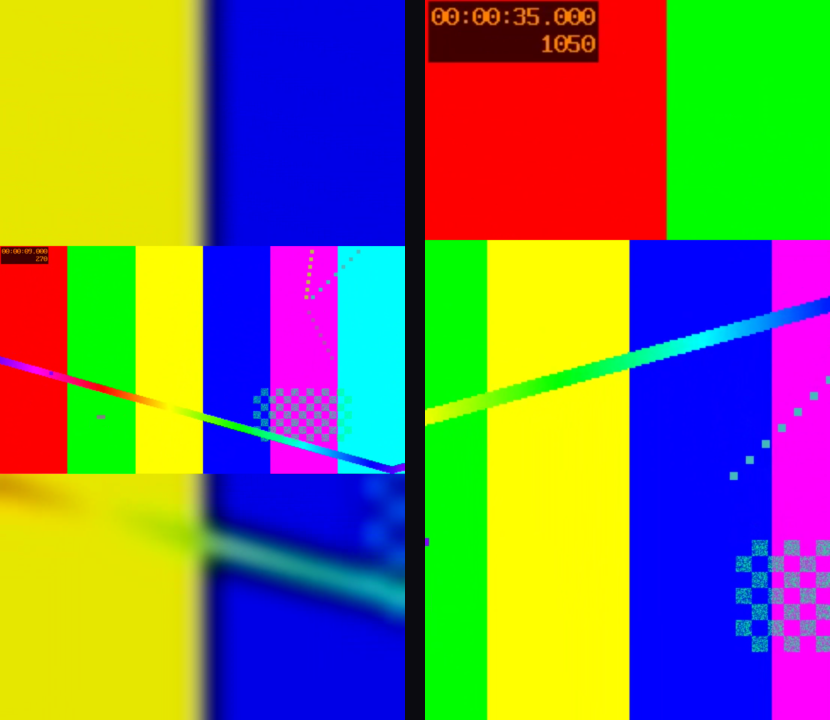

<div align="center">

# ⚡ Prime Clips

### Clip the stream before anyone else.

**Real-time, open-source live-stream clipper.** It watches a live stream, keeps a rolling replay buffer, spots hype moments (audio spikes, chat explosions, "CLIP IT" spam) and cuts a vertical 9:16 short in seconds.

[](https://www.python.org/)
[](LICENSE)
[](https://fastapi.tiangolo.com/)
[](https://ffmpeg.org/)
[](https://github.com/debanganghosh08/Prime_Clips/stargazers)
[](https://www.instagram.com/primus.builds/)

### ⭐ [Star the repo](https://github.com/debanganghosh08/Prime_Clips) so other clippers can find it

<br>


<sub>Real screenshot: a live session on a test stream. The hype meter catches an audio spike and an auto clip is being cut in real time.</sub>

</div>

---

## 🎯 Why

When a mega-launch game drops (hello, GTA 6 hype), **every streamer plays it**, and every clipper races to post the viral moment first.

- 🥇 The **first upload** gets the views.
- 💰 Streamers pay **clip bounties and campaigns** for it.
- ⏱️ Scrubbing a VOD afterwards is too slow, the moment is already everywhere.

Prime Clips sits on the live stream with a replay buffer, so the clip already exists when you press the button (or when the detector fires on its own).

---

## ✨ Features

| | Feature | What it does |
|---|---|---|
| ⏪ | **Replay buffer** | ffmpeg stream-copies the live stream into ~2 s segments and keeps a rolling window (10 min by default). Cutting is a stream copy, no re-encode. |
| 🔥 | **Hype detector** | Fuses audio loudness, chat message rate and hype words/emotes (plus viewers typing "clip") into a 0-100 score, relative to that stream's own baseline. |
| ⚡ | **CLIP NOW** | Dashboard button, the **C** hotkey, and `POST /api/clip` for a Stream Deck or any hotkey tool. |
| 📱 | **4 layouts** | `vertical-blur`, `crop`, `gaming` (facecam on top, gameplay below), `landscape`. |
| 🎮 | **GPU encoders** | Auto-detects NVENC / QSV / AMF (and VideoToolbox on macOS), falls back to x264. Child processes run at low priority. |
| 💬 | **Captions** | Word-by-word burned-in captions via faster-whisper (optional, off by default). |
| 🤖 | **AI titles** | Any OpenAI-compatible LLM: Ollama, OpenRouter, Gemini, and so on. Optional. |
| 📣 | **Discord webhook** | Ping the finished clip to your phone or team, optionally automatically. |
| 📺 | **YouTube Shorts upload** | 🧪 *Experimental, untested.* |
| 🎞️ | **VOD mode** | Point it at a finished stream (URL or local file) and get the top N moments. |
| 🖥️ | **Terminal mode** | `primeclips live <url>`, press Enter to clip. |
| 🐳 | **Docker** | `docker compose up`. |

> ✅ **Tested end-to-end:** Twitch live ingest via streamlink + Twitch chat, local file input, replay buffer, auto and manual clips, the `vertical-blur` / `crop` / `gaming` / `landscape` layouts, GPU encoding (Intel QSV), VOD mode, terminal mode and the dashboard.
>
> 🧪 **Not tested yet (experimental):** YouTube live ingest + chat, Kick, burned-in captions, AI titles, LLM moment picking (VOD `--ai`), Discord webhook, YouTube upload and Docker. Issues and PRs are very welcome!

Chat signal support today: **Twitch** (anonymous IRC, no account or API key) and **YouTube** (experimental, needs the `youtube-chat` extra). Other platforms fall back to audio-only detection.

---

## 🧠 How it works



**Why it is fast and light on CPU**

- ✂️ **Stream copy everywhere possible.** The buffer is written with `-c copy` and a clip is just the segments that cover your time range concatenated, no decode or encode.
- 🧱 **Small segments.** The buffer is cut into 2 s segments (`PRIMECLIPS_SEGMENT_SECONDS`), so the start of a clip snaps to a segment boundary quickly.
- 🪫 **One render at a time.** A single render worker handles re-encodes, so the CPU/GPU stays free for the game and the stream. Cuts never wait in that queue.
- 🎮 **GPU encoder auto-detect.** It test-encodes a frame to find a working hardware encoder instead of assuming one.
- 🐢 **Below-normal priority.** ffmpeg and helper processes are spawned at low priority by default (`PRIMECLIPS_LOW_PRIORITY`).
- 📉 **Cheap detection.** No ML model for hype scoring, just loudness and chat statistics.

The pre/post window is deliberate: chat reacts a few seconds *after* the moment, so auto clips keep 25 s before and 8 s after the trigger by default.

---

## 🖼️ Layouts

<div align="center">

</div>

Real frames rendered by the pipeline from a synthetic test pattern: **blur** layout on the left, **gaming** layout on the right.

| Layout | Use it for |
|---|---|
| `vertical-blur` (default) | Full frame centred over a blurred copy of itself. Safe for anything. |
| `crop` | Hard centre crop to 9:16. Action or a face in the middle. |
| `gaming` | Facecam on top, gameplay below. Set `PRIMECLIPS_FACECAM` to where the facecam sits. |
| `landscape` | Keep 16:9 (only re-encoded if captions are burned in). |

---

## 🚀 Quick start

**1. Install ffmpeg**

```bash
# Windows
winget install Gyan.FFmpeg
# macOS
brew install ffmpeg
# Linux (Debian/Ubuntu)
sudo apt install ffmpeg
```

**2. Install Prime Clips** (Python 3.10+)

```bash
git clone https://github.com/debanganghosh08/Prime_Clips.git
cd Prime_Clips
python -m venv .venv

# Windows (PowerShell)
.venv\Scripts\Activate.ps1
# macOS / Linux
source .venv/bin/activate

pip install -e .            # core: dashboard, Twitch/Kick/YouTube ingest
# or everything optional (captions, YouTube chat, YouTube upload):
pip install -e ".[all]"
```

**3. Check your setup**

```bash
primeclips doctor
```

**4. Launch the dashboard**

```bash
primeclips serve --open
```

**🐳 Docker instead**

```bash
docker compose up
```

Then open http://localhost:8765. Clips land in `./data/clips/`.

> 🔒 The dashboard has no login. Keep it on `localhost` or a trusted network, do not expose it to the internet.

---

## 🎮 Usage

### 🖥️ Dashboard

Run `primeclips serve --open`, paste a live URL, pick a layout and threshold, and start. Hit **⚡ CLIP NOW** or press **C** (when you are not typing in a field) to clip the last N seconds of the most recent live session.

### ⌨️ Terminal live mode

```bash
primeclips live https://twitch.tv/xyz --layout gaming
```

Press **Enter** to clip the last 30 s, type a number then **Enter** to clip the last N seconds, **q** to quit. Useful flags: `--threshold`, `--pre`, `--post`, `--no-auto`, `--no-chat`, `--captions`.

### 🎞️ VOD mode

```bash
primeclips vod https://www.twitch.tv/videos/123456789 --top 5
primeclips vod ./stream.mp4 --top 3 --layout gaming --captions
```

Finds the loudest moments with a rolling local baseline. Flags: `--top`, `--layout`, `--captions`, `--min-len`, `--max-len`, and `--ai` (🧪 experimental: LLM picks moments from a transcript, needs an LLM configured and faster-whisper).

### 🎛️ Stream Deck / hotkey

Any tool that can send an HTTP request works:

```bash
curl -X POST http://localhost:8765/api/clip \
  -H "Content-Type: application/json" \
  -d '{"seconds": 30}'
```

It clips the most recent live session. Full route list in [docs/API.md](docs/API.md).

### 🏁 Pro tips for winning the race

- 📉 **Lower the threshold** for chill streamers (their big moments are quieter in absolute terms, try `--threshold 55`).
- 🚫 **Captions off for speed.** They cost CPU and seconds, and being first matters more than being pretty.
- 📣 **Set a Discord webhook** (`PRIMECLIPS_DISCORD_WEBHOOK`, optionally `PRIMECLIPS_DISCORD_AUTO=true`) and post straight from your phone.
- 🧑‍🚀 **Set `PRIMECLIPS_FACECAM`** (`x,y,w,h` as fractions of the frame, default `0,0,0.28,0.30`) so the `gaming` layout crops the right corner.
- ⌨️ **Keep a hotkey ready.** Manual clip plus auto-detect together beat either alone.

---

## ⚙️ Configuration

Everything is driven by `PRIMECLIPS_*` environment variables or a `.env` file in the folder you run from. Copy [`.env.example`](.env.example) to `.env` and uncomment what you want to change.

| Variable | Default | Description |
|---|---|---|
| `PRIMECLIPS_DATA_DIR` | `data` | Where clips, buffers and downloads live |
| `PRIMECLIPS_FFMPEG` / `PRIMECLIPS_FFPROBE` | `ffmpeg` / `ffprobe` | Binary names or paths |
| `PRIMECLIPS_SEGMENT_SECONDS` | `2.0` | Replay buffer segment length |
| `PRIMECLIPS_BUFFER_MINUTES` | `10.0` | Rolling replay buffer length |
| `PRIMECLIPS_QUALITY` | `best` | Stream quality passed to streamlink / yt-dlp |
| `PRIMECLIPS_ENCODER` | `auto` | `auto`, `libx264`, `h264_nvenc`, `h264_qsv`, `h264_amf` |
| `PRIMECLIPS_THREADS` | `2` | Threads for x264 and captions |
| `PRIMECLIPS_LOW_PRIORITY` | `true` | Run child processes at low priority |
| `PRIMECLIPS_RENDER_FPS` | `30` | Output fps (`source` keeps the original) |
| `PRIMECLIPS_FACECAM` | `0,0,0.28,0.30` | Facecam rectangle `x,y,w,h` for the `gaming` layout |
| `PRIMECLIPS_LAYOUT` | `vertical-blur` | Default layout |
| `PRIMECLIPS_AUTO_CLIP` | `true` | Auto-clip on hype |
| `PRIMECLIPS_THRESHOLD` | `70` | Hype score (0-100) that triggers an auto clip |
| `PRIMECLIPS_PRE` / `PRIMECLIPS_POST` | `25` / `8` | Seconds kept before / after the trigger |
| `PRIMECLIPS_COOLDOWN` | `45` | Minimum seconds between two auto clips |
| `PRIMECLIPS_CHAT` | `true` | Read live chat |
| `PRIMECLIPS_CAPTIONS` | `false` | Burn captions (needs faster-whisper) |
| `PRIMECLIPS_WHISPER_MODEL` | `base` | faster-whisper model name |
| `PRIMECLIPS_LLM_BASE_URL` | *(empty)* | Any OpenAI-compatible `/v1` endpoint |
| `PRIMECLIPS_LLM_API_KEY` | *(empty)* | API key (not needed for local Ollama) |
| `PRIMECLIPS_LLM_MODEL` | *(empty)* | Model name |
| `PRIMECLIPS_TITLE_TEMPLATE` | `{channel} {reason} 😱` | Fallback title when no LLM title is made |
| `PRIMECLIPS_HASHTAGS` | `#shorts #gaming #clips` | Appended to Discord / YouTube posts |
| `PRIMECLIPS_DISCORD_WEBHOOK` | *(empty)* | Discord webhook URL |
| `PRIMECLIPS_DISCORD_AUTO` | `false` | Post every finished clip automatically |
| `PRIMECLIPS_YOUTUBE_CLIENT_SECRETS` | *(empty)* | Path to OAuth `client_secrets.json` (🧪 experimental) |
| `PRIMECLIPS_YOUTUBE_PRIVACY` | `public` | Privacy status for YouTube uploads (🧪 experimental) |

AI titles need both `PRIMECLIPS_LLM_BASE_URL` and `PRIMECLIPS_LLM_MODEL`, for example Ollama at `http://localhost:11434/v1`.

---

## 🗺️ Roadmap

- [ ] Kick chat
- [ ] TikTok / Instagram upload
- [ ] Face-tracking reframe
- [ ] Multi-stream dashboard grid
- [ ] OBS plugin
- [ ] Per-game event detectors (kill feed, wanted-level OCR)

---

## 🙏 Standing on the shoulders of giants

Prime Clips was inspired by a lot of great open-source work. These are credited as **inspiration**, no code was copied from them.

**Clipping and shorts tools**
- [mutonby/openshorts](https://github.com/mutonby/openshorts)
- [FujiwaraChoki/supoclip](https://github.com/FujiwaraChoki/supoclip)
- [ColinGPT9/clips-studio](https://github.com/ColinGPT9/clips-studio)
- [JeremySNR/cutawan](https://github.com/JeremySNR/cutawan)
- [m-hoseyny/teek](https://github.com/m-hoseyny/teek)
- [Anil-matcha/AI-Youtube-Shorts-Generator](https://github.com/Anil-matcha/AI-Youtube-Shorts-Generator)
- [Shaarav4795/ClippedAI](https://github.com/Shaarav4795/ClippedAI)
- [fralapo/clippyme](https://github.com/fralapo/clippyme)
- [oktaydbk54/vibeclip](https://github.com/oktaydbk54/vibeclip)
- [NaufalRizqullah/opensource-clipping](https://github.com/NaufalRizqullah/opensource-clipping)

**Editing and recording**
- [ClipsAI/clipsai](https://github.com/ClipsAI/clipsai)
- [RayVentura/ShortGPT](https://github.com/RayVentura/ShortGPT)
- [WyattBlue/auto-editor](https://github.com/WyattBlue/auto-editor)
- [mifi/lossless-cut](https://github.com/mifi/lossless-cut)
- [obsproject/obs-studio](https://github.com/obsproject/obs-studio)

**Foundations Prime Clips runs on**
- [streamlink/streamlink](https://github.com/streamlink/streamlink)
- [yt-dlp/yt-dlp](https://github.com/yt-dlp/yt-dlp)
- [SYSTRAN/faster-whisper](https://github.com/SYSTRAN/faster-whisper)
- [FFmpeg](https://ffmpeg.org)

---

## ⚖️ Responsible clipping

Clipping is a community practice, not a free pass.

- 🤝 **Respect streamers and platforms.** Follow each streamer's clipping rules and the platform's terms of service.
- ✅ **Get permission or join official clip campaigns** before reposting or monetizing someone's content.
- 🔐 Prime Clips **does not bypass DRM or paywalls**. It only reads streams you could already watch.
- 📛 Credit the streamer when you post.

You are responsible for what you publish.

---

## 🤝 Contributing

Bug reports, ideas and PRs are welcome. See [CONTRIBUTING.md](CONTRIBUTING.md).

```bash
pip install pytest && python -m pytest -q   # fast tests, no ffmpeg or network needed
```

## 📄 License

[MIT](LICENSE) © 2026 Debangan Ghosh

---

<div align="center">

Made with ❤️ by **Debangan Ghosh**

<a href="https://www.instagram.com/primus.builds/"></a>

[@primus.builds](https://www.instagram.com/primus.builds/)

If this saved you time, ⭐ the repo and follow for more builds.

</div>
